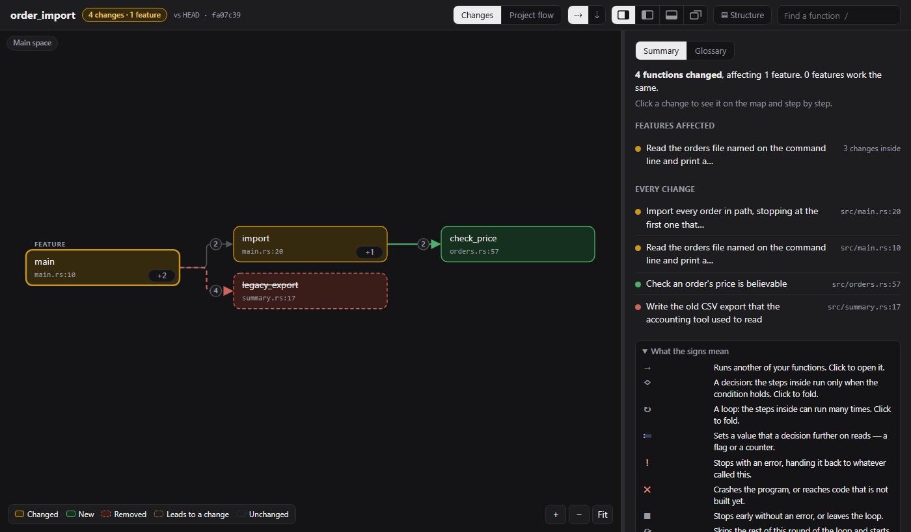
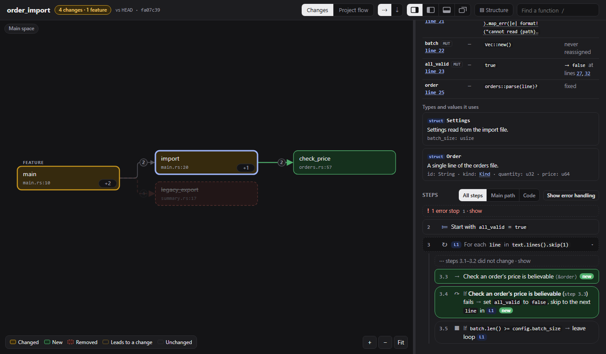
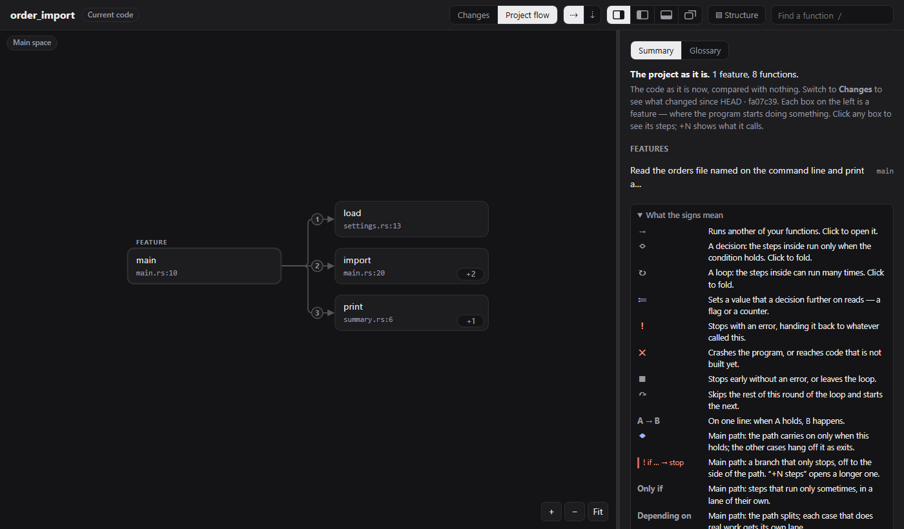

# What the flow page looks like

These screenshots come from [`review.html`](review.html), which flowlens wrote
for the small program in [`sample/`](sample): an order import with a `main`,
a parser, settings and a summary. Its [`before`](sample/before) and
[`after`](sample/after) versions differ by one change: the import loop now
checks each order's price (`check_price` is new), and the old
`legacy_export` is gone.

```bash
flowlens . --review
```

`review.html` is a single, self-contained page: open it in a browser, no
server and no network needed. To rebuild it, run [`./generate.sh`](generate.sh).

## The map, and what changed

Boxes are functions, arrows are calls, numbered in the order they happen,
flowing from each **feature** (where the program starts doing something) to
what it uses. The **Changes** view shows only what changed and the path from
a feature down to it: amber changed, green new, red removed.



## A function's steps

Click a box for its details: what it takes and gives back, how it can end,
its variables, and its **steps** in plain words. New and changed steps are
marked. *All steps*, *Main path* and *Code* are three ways to read the same
function.



## The whole project

**Project flow** shows the whole program as the code is now, compared with
nothing. It's also all you get in a folder with no git history.


